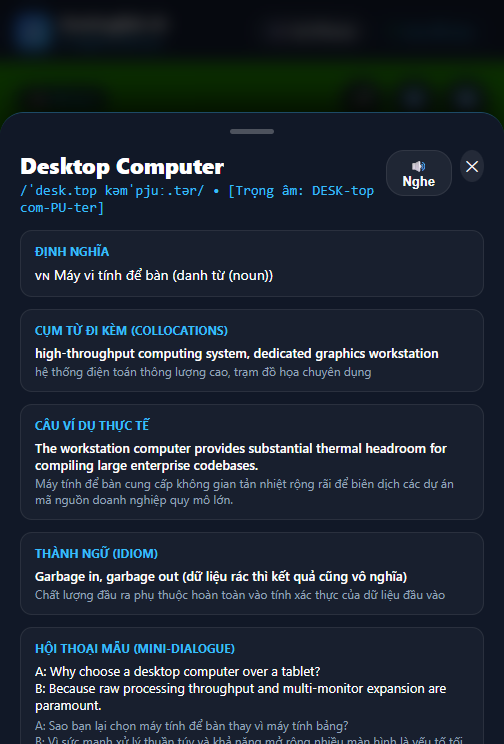
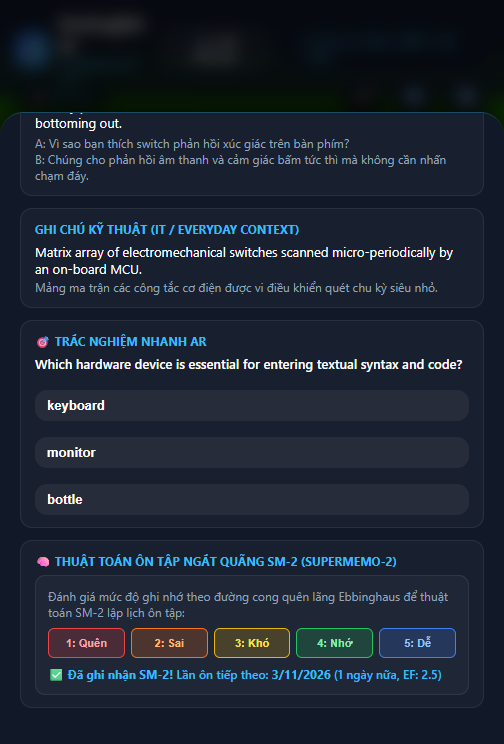
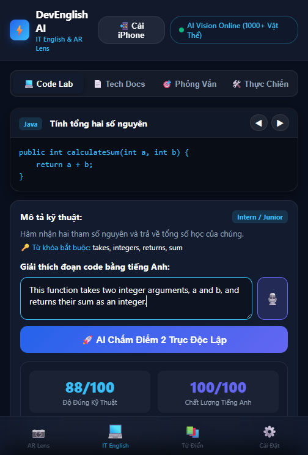
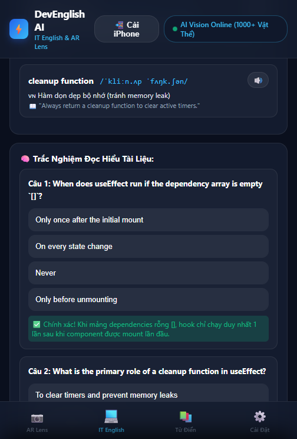
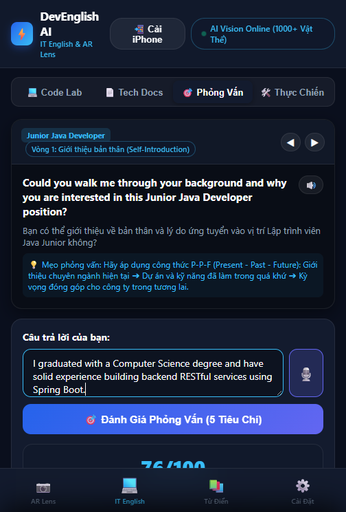
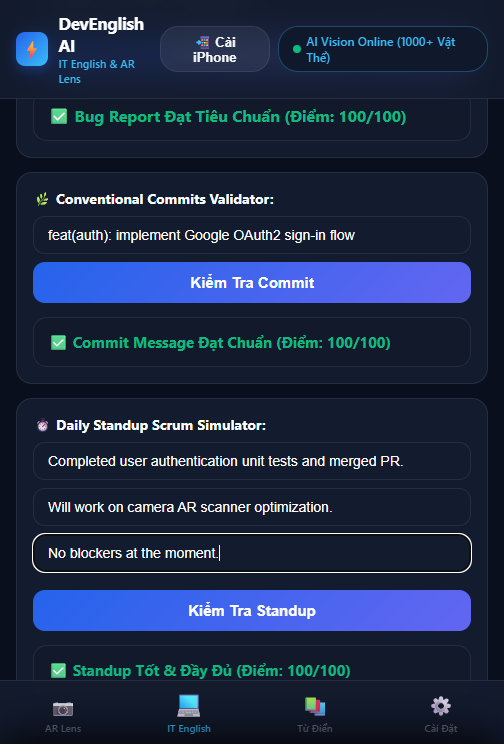
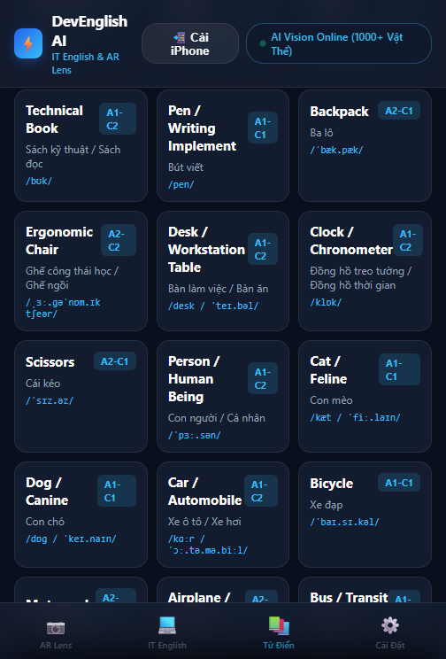
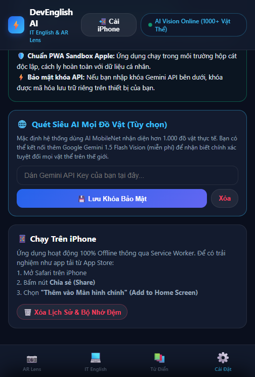

# 🚀 DEVENGLISH AI
### Nền Tảng Học Tiếng Anh Thông Minh Dành Cho Sinh Viên CNTT & Lập Trình Viên (Android & iOS PWA)

[](file:///c:/Users/Admin/Documents/hoctienganh/tienganhAi/app/build/outputs/apk/debug/app-debug.apk)
[](docs/THESIS_SYSTEM_ARCHITECTURE.md)
[-success?style=for-the-badge&logo=checkmarx)](file:///c:/Users/Admin/Documents/hoctienganh/tienganhAi/app/src/test/)
[%20%7C%20Web-blue?style=for-the-badge&logo=apple)](file:///c:/Users/Admin/Documents/hoctienganh/tienganhAi/pwa/)
[](file:///c:/Users/Admin/Documents/hoctienganh/tienganhAi/pwa/sw.js)
[](file:///c:/Users/Admin/Documents/hoctienganh/tienganhAi/docs/CEFR_LEVEL_CALIBRATION_RULES.md)

---

## 📖 GIỚI THIỆU SẢN PHẨM

**DevEnglish AI** không chỉ là một ứng dụng học từ vựng thông thường. Đây là một nền tảng đào tạo tiếng Anh thực chiến chuyên sâu, được thiết kế chuyên biệt cho sinh viên CNTT, kỹ sư phần mềm trẻ và người chuẩn bị phỏng vấn tại các doanh nghiệp công nghệ toàn cầu.

Ứng dụng kết hợp giữa **công nghệ thị giác máy tính AR Real-Time Lens**, **trí tuệ nhân tạo đánh giá độc lập 2 trục (Độ đúng Kỹ thuật vs Chất lượng Tiếng Anh)**, và **bộ mô phỏng môi trường làm việc doanh nghiệp (Scrum Standup, Jira Bug Report, GitHub Code Review)**.

---

## 📸 SHOWCASE TÍNH NĂNG & KẾT QUẢ KIỂM THỬ THỰC TẾ

Toàn bộ các tính năng dưới đây đã được kiểm thử tự động toàn diện và chụp ảnh thực tế từ hệ thống:

---

### 1. 📷 AR Camera Real-Time Lens (Nhận Diện Vật Thể Thời Gian Thực)
*Đưa Camera quét tới đâu, hiển thị ngay từ vựng tiếng Anh, phiên âm IPA, nghĩa tiếng Việt và khung nhắm công nghệ cao.*



- **Cơ chế hoạt động:** Sử dụng camera sau (`facingMode: environment`) với khung bounding box neon rực rỡ, góc nhắm mục tiêu (Target Reticle) thông minh.
- **Tương tác trực tiếp:** Thẻ từ vựng nổi hiển thị đồng thời từ tiếng Anh, phát âm IPA, nghĩa tiếng Việt và nút bấm nghe phát âm tức thì.
- **Tính năng mở rộng:** Bật/tắt đèn Flash (`Torch`), tạm dừng khung hình (`Freeze`), lật camera trước/sau, quét thủ công đồ vật bất kỳ trong phòng.

---

### 2. 📚 Bách Khoa Toàn Thư Từ Vựng (Encyclopedic Deep Knowledge Sheet)
*Chạm vào bất kỳ đồ vật nào được nhận diện để mở bảng tri thức bách khoa đa tầng.*



- **Thông tin chi tiết chuẩn CEFR (A1 - C1):**
  - Định nghĩa chuyên sâu & từ loại (`noun, verb, adjective...`).
  - Cụm từ thông dụng đi kèm (*Collocations*).
  - Câu ví dụ thực tế trong ngữ cảnh đời sống và công nghệ.
  - Thành ngữ bản xứ (*Idioms*) và hội thoại ngắn (*Mini-dialogue*).
  - Ghi chú kỹ thuật CNTT (*Technical Context*).
  - **Trắc nghiệm nhanh AR (Pop-Quiz):** Tương tác kiểm tra trí nhớ tức thì, lưu tiến độ học tự động.
- **Thuật toán Ôn tập Ngắt quãng SuperMemo-2 (SM-2):** Đánh giá mức độ ghi nhớ (1: Quên $\to$ 5: Dễ) theo quy luật đường cong quên lãng Ebbinghaus, tự động điều chỉnh Hệ số dễ nhớ $EF' = \max(1.3, EF + \Delta EF)$ và khoảng cách ngày ôn tập $I(n)$ để tri thức được củng cố vững chắc vào trí nhớ dài hạn.
- **Kiến trúc hệ thống học thuật:** Xem chi tiết luận văn kiến trúc cấp công nghiệp tại [THESIS_SYSTEM_ARCHITECTURE.md](docs/THESIS_SYSTEM_ARCHITECTURE.md).

---

### 3. 💻 Code-to-English AI Lab (Tính Năng Chủ Lực #1)
*Đọc hiểu đoạn code lập trình và giải thích logic bằng tiếng Anh, AI chấm điểm 2 trục độc lập.*



- **Đa ngôn ngữ lập trình thực tế:** Java (Spring/OOP), Python (AI/ML), JavaScript (Async/Await), SQL (Join/Aggregate), C# (Guard Clauses).
- **IDE Dark Theme chuyên nghiệp:** Giao diện lập trình giả lập trực quan với font `monospace`.
- **Chấm điểm 2 trục độc lập (Dual Rubric Scoring):**
  - **Technical Correctness Score (0 - 100):** Đánh giá mức độ hiểu đúng luồng xử lý dữ liệu và các từ khóa bắt buộc (*Required Technical Keywords*).
  - **English Expression Score (0 - 100):** Đánh giá ngữ pháp, độ trôi chảy kỹ thuật và cấu trúc câu mô tả.
- **Native Phrasing Sample:** Cung cấp câu giải thích mẫu chuẩn văn phong kỹ sư bản xứ kèm nút phát âm giọng đọc.

---

### 4. 📄 Technical Documentation Reader (Tính Năng Chủ Lực #2)
*Luyện đọc tài liệu kỹ thuật chuẩn quốc tế, bóc tách thuật ngữ và trắc nghiệm đọc hiểu tương tác.*



- **Kho bài đọc công nghệ hiện đại:** *React Hooks Lifecycle*, *Docker Containerization Architecture*, *Microservices & Event-Driven Systems*.
- **Plain English Simplified:** Bản giải thích đơn giản hóa giúp người học nắm bắt nội dung cốt lõi nhanh chóng mà không bị quá tải thuật ngữ.
- **Extracted Vocabulary Cards:** Bóc tách thuật ngữ chuyên ngành, phiên âm IPA, định nghĩa tiếng Anh & tiếng Việt.
- **Interactive Comprehension Quiz:** Bài tập trắc nghiệm kiểm tra mức độ hiểu tài liệu, chấm điểm tức thì kèm giải thích chi tiết.

---

### 5. 🎯 IT English Mock Interview Simulator (Tính Năng Chủ Lực #3)
*Mô phỏng phỏng vấn xin việc tuyển dụng IT bằng tiếng Anh qua 4 vòng chuẩn doanh nghiệp.*



- **4 Vị trí tuyển dụng:** *Junior Java Developer, Frontend/Web Developer, AI Engineer, QA/QC Automation*.
- **4 Vòng phỏng vấn chuẩn hóa:**
  - *Round 1:* Giới thiệu bản thân & kinh nghiệm dự án (Formula P-P-F).
  - *Round 2:* Kiến thức kỹ thuật cốt lõi (Technical Deep Dive).
  - *Round 3:* Giải quyết vấn đề & Debugging hệ thống thực tế.
  - *Round 4:* Văn hóa Agile & Làm việc nhóm (Phương pháp STAR).
- **Chấm điểm 5 tiêu chí chi tiết:** Technical Relevance, Vocabulary Range, Fluency, Grammar, và gợi ý câu trả lời mẫu **Band 7.5+**.

---

### 6. 🛠️ Workplace Practice Tools (Bộ Công Cụ Thực Chiến Doanh Nghiệp)
*Rèn luyện các kỹ năng giao tiếp công việc hàng ngày trong môi trường quốc tế.*



- **🐞 Bug Report English Trainer:** Luyện viết báo cáo lỗi chuẩn Jira/GitHub (Title, Steps to Reproduce, Expected, Actual, Environment) với AI chấm độ chuẩn xác.
- **🌿 Conventional Commits Validator:** Kiểm tra commit theo chuẩn quốc tế (`feat:`, `fix:`, `docs:`, `refactor:`, `test:`, `chore:`), loại bỏ thì quá khứ không chuẩn.
- **⏱️ Daily Standup Scrum Simulator:** Luyện phản xạ trả lời 3 câu hỏi kinh điển trong buổi họp Daily Scrum (Hôm qua làm gì, Hôm nay làm gì, Có blocker gì không).

---

### 7. 📚 Bách Khoa Tri Thức Từ Vựng (Visual Vocabulary Dictionary Hub)
*Tra cứu toàn bộ 35+ vật thể, công nghệ và phân loại cấp độ CEFR.*



- Thanh tìm kiếm tức thì theo từ khóa tiếng Anh hoặc tiếng Việt.
- Phân loại rõ ràng cấp độ CEFR từ A1 đến B2.
- Thẻ từ vựng trực quan, bấm vào để mở ngay toàn bộ bài học và bài tập trắc nghiệm liên quan.

---

### 8. ⚙️ Cài Đặt Âm Thanh, Tiến Độ & Chế Độ Offline
*Theo dõi tiến độ học tập và tùy chỉnh giọng đọc bản xứ.*



- **Thống kê thời gian thực:** Số lượng vật thể đã quét AR, số từ vựng đã thành thạo, tổng điểm bài tập.
- **Tùy chỉnh giọng đọc:** Chuyển đổi linh hoạt giữa giọng **Anh - Mỹ (`en-US`)** và **Anh - Anh (`en-GB`)**.
- **100% Offline Service Worker:** Bộ đệm lưu trữ toàn diện, không cần kết nối mạng vẫn mở app học tập bình thường.

---

## 📱 HƯỚNG DẪN CÀI ĐẶT & SỬ DỤNG

### 1. Cài đặt trên điện thoại Android (File APK)
- Tải file cài đặt hoàn chỉnh: [`release_binaries/app-debug.apk`](file:///c:/Users/Admin/Documents/hoctienganh/tienganhAi/release_binaries/app-debug.apk) *(hoặc trong thư mục `app/build/outputs/apk/debug/app-debug.apk`)*.
- Chép vào điện thoại Android và mở file để cài đặt ngay lập tức.

### 2. Sử dụng trên điện thoại iPhone (iOS PWA)
- Nhấp đúp chuột vào file: [`start_pwa.bat`](file:///c:/Users/Admin/Documents/hoctienganh/tienganhAi/start_pwa.bat) trên máy tính.
- Màn hình terminal sẽ xuất hiện địa chỉ IP nội bộ, ví dụ: `http://192.168.1.15:8080`.
- Mở trình duyệt **Safari** trên iPhone, gõ địa chỉ trên.
- Bấm nút **Chia sẻ (Share ⎋)** > Chọn **"Thêm vào Màn hình chính" (Add to Home Screen)**.
- Mở icon ngoài màn hình chính iPhone để trải nghiệm ứng dụng toàn màn hình y hệt như tải từ App Store!

---

## 🛠️ LỆNH BIÊN DỊCH & KIỂM THỬ MÃ NGUỒN

```bash
# 1. Chạy toàn bộ 144 Unit Tests kiểm thử tự động:
./gradlew testDebugUnitTest

# 2. Biên dịch file APK Android Debug:
./gradlew assembleDebug

# 3. Khởi chạy máy chủ PWA cho iPhone & Web:
python pwa/serve.py

# 4. Chạy kiểm thử tự động giao diện E2E và chụp ảnh màn hình:
python tools/test_and_capture.py
```

---

## 📦 GÓI BÀN GIAO SẢN PHẨM KHÁCH HÀNG

- **Gói Full Toàn Diện (Có APK + Toàn Bộ Mã Nguồn + PWA + Docs):**
  [`DevEnglish_AI_Customer_Full_Delivery.zip`](file:///c:/Users/Admin/Documents/hoctienganh/tienganhAi/DevEnglish_AI_Customer_Full_Delivery.zip) (45.8 MB)
- **Gói Mã Nguồn Tinh Gọn (Chuyên gửi Email/Zalo):**
  [`DevEnglish_AI_SourceCode_Only.zip`](file:///c:/Users/Admin/Documents/hoctienganh/tienganhAi/DevEnglish_AI_SourceCode_Only.zip) (1.05 MB)
- **Hướng dẫn bàn giao cho khách hàng:**
  [`CUSTOMER_HANDOFF_README.md`](file:///c:/Users/Admin/Documents/hoctienganh/tienganhAi/CUSTOMER_HANDOFF_README.md)
